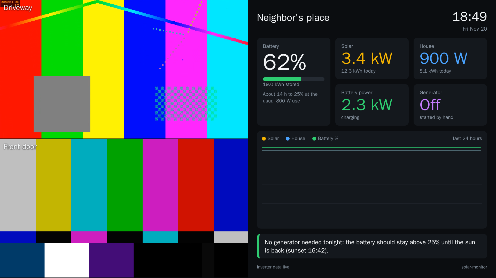

# solar-monitor-pi

A Raspberry Pi image for monitoring a solar installation that uses EG4 / LuxPower inverters with the
WiFi datalogger dongle. Plug the Pi into the same network as the dongles and it finds them, starts
collecting data and serves dashboards. Nothing is sent to the internet, and the inverters are only
read, never changed.

## What's on it

| Part | What it does | Where |
|---|---|---|
| Setup page | Start page: dongles found, links, site setup form | `http://<pi>/` (port 80) |
| [lxp-bridge-go](https://github.com/jgulick48/lxp-bridge-go) | Reads every inverter's dongle (read-only mode) and publishes the values | internal |
| Mosquitto | MQTT broker between the bridge and Home Assistant | localhost only |
| VictoriaMetrics | Long-term history (5 years) of every inverter value | localhost only |
| Grafana | Dashboards, viewable without logging in | `http://<pi>:3000` |
| Home Assistant | Inverter entities (MQTT discovery), the Solar dashboard, alerts to phones | `http://<pi>:8123` |
| Advisor | Weekly analysis: batteries, panels, inverter or generator? | `http://<pi>/advisor` |
| Backups | Nightly backup to a USB stick, and restore | `http://<pi>/backup` |
| Battery health | Cell spread near full, temperatures, SOH, cycles, capacity check, BMS faults | `http://<pi>/battery` |

| Generator log | Every generator run, hours since the last service, service reminder | `http://<pi>/generator` |
| Wall display | Dashboard and up to two cameras on a screen plugged into the Pi's HDMI port | `http://<pi>/display` |
| go2rtc | Turns the cameras' RTSP(S) streams into video the display's browser can play | localhost only |
| cloudflared | Optional remote access to Home Assistant through your own Cloudflare account | `https://<name>.<your domain>` |
| cloudflared-support | Optional remote support: a helper's own Cloudflare Tunnel, while the owner allows it | the helper's hostnames |

## Hardware

- Raspberry Pi 4 (2 GB is enough, 4 GB recommended) and the official 5.1 V 3 A power supply.
- A **128 GB SSD** in a USB 3 enclosure with UASP (or a USB SSD such as a Samsung T7 / SanDisk Extreme).
  Five years of history for two inverters is a few GB; the extra space spreads the writes so the drive
  lasts. SATA-in-USB enclosures are safer than NVMe on a Pi 4 (its USB ports share about 1.2 A).
- Wired Ethernet on the same network (subnet) as the inverter dongles.
- Optional: a 1080p monitor or TV on the Pi's HDMI port (micro-HDMI 0, next to the power socket) for the
  wall display. Plugging it in, even later, starts the display.

## First boot

1. Flash the image to the SSD, plug it into the Pi's blue USB 3 port, connect Ethernet, power on.
2. Wait about five minutes, then open `http://solar-monitor.local/` (or the Pi's IP from the router).
3. The start page lists the dongles it found. Click **Finish setup** and enter the location, time zone,
   batteries, panels and generator. Saving applies it to Home Assistant and Grafana.
4. Open Home Assistant from the start page and create your account. The inverter entities are already
   there.

Give each dongle a fixed IP (DHCP reservation) in the router if you can. If a dongle's IP changes anyway,
the hourly scan finds it again by its serial number.

## Wall display



With a screen on the HDMI port the Pi shows a dashboard, laid out for 1920x1080:

- **Cameras** (left half, two stacked 960x540 tiles; without cameras the power figures use the whole screen).
- **Battery** (%, kWh stored, how long it lasts at the usual use), **solar**, **house load**, **battery power**
  (charging/discharging) and **generator**, with today's totals and the last 24 hours as a chart.
- **Notes**: dongles offline, inverter faults, low battery and, for a hand-started generator, from mid-afternoon on
  whether the battery lasts until the sun is back ("Start the generator before dark: ... about 4.2 kWh more is
  needed"), from the house's expected use and the solar forecast: a dull day tomorrow counts too
  ("tomorrow looks dull (about 6 kWh of solar expected) ...").
- **Any screen**: the screen mode comes from the TV's EDID: its own preferred mode, except that screens bigger than
  1920x1200 (4K TVs) run at 1920x1080, which the Pi handles much better with cameras and the TV scales up. The layout
  scales with the tighter of width and height, so 4:3, 16:10, 21:9 and 720p/768p screens fit, and a screen on its
  side gets the cameras on top and the figures below. The setup page shows the screen found and the mode used.
- **Clock**: 12-hour (4:41 PM) or 24-hour, set on the setup page (by default 12-hour with US units); the same format is
  used in the generator advice and the daily summary.
- **Sounds**: short chimes through the screen's speakers (HDMI) when a UniFi Protect camera sees something (a car horn for vehicles): doorbell
  ring and person by default, vehicle, animal and package optional, with a volume and *not during the screen-off
  hours*. *Play a test sound* on the setup page checks it. Repeats are limited: the same alert (same camera, same
  kind) at most once a minute by default, any two sounds at least 5 seconds apart, and the doorbell always rings
  (all adjustable); the camera still comes to the front of the screen. The kiosk points its sound at the HDMI port the screen is
  on (`~solar-display/.asoundrc`, Pi 4: HDMI-A-1 = vc4hdmi0); the screen or TV needs speakers.
- **Voice announcements** (optional, like UniFi's Alarm Manager; setup page: *Optional features* → *Voice
  announcements*): after the chime, or instead of it, Piper says what a camera saw, "Person at the Front door" /
  "Someone's at the Front door" (wording under *Cameras*, `{object}` and `{camera}`), in one of four English
  voices. Other features can use it for their own alerts (`modules.voice.announce(stack, text, chime=...)`; the display
  speaks announcements from the last two minutes, not during quiet hours). Piper runs in the optional `tts` service
  (`rhasspy/wyoming-piper`, the voice Home Assistant uses for local voice); it isn't in the image (about 200 MB):
  turning voice on downloads it and the voice once, then it works offline. Phrases are made ahead of time and cached
  (`state/tts-cache`). *Play a test announcement* on the setup page checks it.
- **Burn-in protection**: every 20 minutes the layout changes (cameras on the left or the right, or without cameras
  the tiles in order or reversed; the figures top-down or flipped, clock at the bottom), with a short fade, and every
  minute the whole page drifts a few pixels along a small circle, so no label, border or grid line stays on the same
  pixels for hours. `http://<pi>/display?layout=0` (to 3) shows one layout without rotating. The screen can also be
  switched off for set hours on the setup page.

### Solar forecast

`solar-collector` keeps Open-Meteo's irradiance forecast for each array (the same hourly request it already makes)
and turns it into expected output per hour for today and the next five days (`state/forecast.json`), scaled by the
advisor's calibration of this site's panels once it has one (0.8 of the model until then) and capped at the
inverters' solar input. It shows on the display's solar tile, as `sensor.site_solar_forecast_today` / `_tomorrow` in
Home Assistant, and drives the generator advice, which steps the battery through tonight and tomorrow in 15-minute
steps (forecast solar against the usual use) instead of assuming the sun takes over two hours after sunrise. With no
fresh forecast (no internet) the advice falls back to that rule.

It runs Chromium in kiosk mode inside `cage` (a one-app Wayland compositor; no desktop) as the locked
`solar-display` account (`solar-display.service`). It only starts when the display is turned on on the setup page,
the kiosk software is installed and a screen is connected; plugging a screen in starts it (udev rule). The browser's
profile lives in RAM. The same page is at `http://<pi>/display` from other computers, without the cameras.

**Camera checks.** The box re-fetches UniFi Protect's stream links at startup and every hour when Protect has changed
them (an old link can connect and send nothing), and checks each camera's video codec. The screen plays H.264 only: a
camera sending H.265 (Protect's *Enhanced Encoding*) shows a note in its place instead of a black box, and the setup
page says so; turn Enhanced Encoding off for that camera in Protect.

**Dongles that are gone** (a replaced dongle, a box moved to another site, test simulators) can be removed with
*Forget* on the start page: from the monitor, the bridge and Home Assistant.

**Camera load.** Playing the camera video is nearly all of the box's CPU work (test Pi 4: 41% of its four
cores with two medium-quality UniFi Protect streams, 27% with low, 5% with no video). The Protect section's *Camera
picture* is *Automatic* by default: low on a Pi 4, medium on a Pi 5 (boxes that update switch by themselves). The
video stops while the screen is off. go2rtc runs on the host network, listening on 127.0.0.1 only.

**Weather** shows in the same panel as the solar figures (setup page: *Optional features* → *Weather*, on by default;
how many forecast days and how fast they page are under *Weather on the screen*): now (temperature, conditions, feels-like, wind speed, gusts and direction, humidity, rain today), the next
days (high/low, rain chance, wind) and, where there's room, the next 12 hours. The forecast comes from Open-Meteo (free,
no key; every 30 minutes); a weather station set up on the setup page (Ecowitt, Tempest, WeatherLink, or pushing to
the box) supplies "now" with its own readings, wind included. In the US, National Weather Service alerts for the site
(every 10 minutes) appear with the other notes, red for severe ones. If the panel doesn't fit the screen (long notes, a
small screen), the hourly row is left out first.

**When the screen is on** (setup page, *Screen*): always; during **on-hours** (up to four lines such as
Mon-Fri 06:30-22:00 and Sat-Sun 08:00-01:00, past midnight allowed); **when someone's in the room**, from Home
Assistant occupancy, motion or presence sensors (`binary_sensor.*`, `person.*`, `input_boolean.*`; stays on for a set
time after the room empties); or during the on-hours *and* when someone's there. Camera events (doorbell, person, ...)
can turn it on for a few minutes outside those times. When it's off, the HDMI picture is switched off (`wlr-randr`;
most monitors and many TVs go to standby by themselves) and, if ticked, the **TV is put in standby and woken over
HDMI-CEC** (`cec-ctl`; SimpLink, Anynet+, Bravia Sync...), switched to the box's input when it wakes. The setup page
shows whether the TV answers CEC, and *Test: screen off for 15 seconds* tries it. Occupancy reaches the box through an
automation the box writes into Home Assistant (`packages/solar_display.yaml`); if Home Assistant goes quiet for 20
minutes the screen stays on. `solar-display-power.service` does the switching; CEC is sent only when the screen's state
changes, so a TV turned off with its remote stays off until the next change.

### Cameras (UniFi Protect)

Cameras are an optional feature (setup page: *Optional features* → *Cameras*; on for boxes that had cameras
before). Turning it off stops go2rtc and the Protect event listener and keeps the camera settings.

Up to 16 cameras; two are on screen at a time and they take turns every 15 seconds (only the two on screen are
played, so more cameras don't load the Pi).

**From UniFi Protect** (setup page, *UniFi Protect cameras*): enter the console's address and an API key (UniFi OS
-> Settings -> Control Plane -> Integrations -> Create API Key), tick the cameras for the screen and save. The box
fills in their stream links itself (Protect's Integration API; it creates a *medium* stream where there is none) and
keeps a connection to Protect's event stream: when a camera sees a **person, vehicle, animal or package** it comes to
the front of the screen with an amber frame and a label, and a **doorbell ring** with a red one, until a minute after
the event ends. Plain motion does the same only if *Also bring cameras to the front for plain motion* is ticked. The
key is kept in `state/protect.json` (mode 600); the console's self-signed certificate isn't checked.

**Phone notifications with the picture** (off until chosen): setup page, *Cameras*: tick *Doorbell* and/or *Person*.
When a UniFi Protect camera on the screen's list rings or sees a person, the box fetches the camera's picture from
the console and sends it through the notifications module: to its phones, with its quiet hours (a person waits
until morning; so does the doorbell, as a warning). The same camera and kind is sent at most every 5 minutes (a
choice from 1 minute to 1 hour). The picture shows in the Home Assistant app, at home and remotely. ntfy shows it as a
preview while remote access is on: the push carries a link to the picture on Home Assistant's public address. Pictures are kept for 2 days in `homeassistant/www/snap` under names that can't be guessed: Home
Assistant serves that folder without a login, which is what lets the app show them.

**By stream link** (any RTSP/RTSPS H.264 camera, no events): setup page, *Cameras*: name each camera and
paste its stream link. A camera added this way and later picked from UniFi Protect is dropped from the manual list
(same stream token or name), and the screen never shows the same camera in both places. In UniFi Protect: open the camera
-> Settings -> Advanced -> RTSPS, turn on **Medium** quality (720p: sharp enough for a 960x540 tile and light on
the Pi; the Pi 4 decodes H.264 in hardware) and copy the `rtsps://<console>:7441/<token>?enableSrtp` link.
`go2rtc` reads the streams (RTSPS without checking Protect's self-signed certificate) and serves them to the
display over MSE on 127.0.0.1 only, so the pictures aren't reachable from the network. The links are kept in
`state/display.json` and `go2rtc/go2rtc.yaml` (mode 600) and aren't shown again on the setup page (the token in
the link is effectively a password). Any camera with an RTSP/RTSPS H.264 stream works the same way.

For camera entities, motion and doorbell events in Home Assistant, add the **UniFi Protect** integration in
Home Assistant (Settings -> Devices & services; it's usually discovered automatically) with a local Protect user.

## Home Assistant: Solar dashboard and alerts


Home Assistant comes with a **Solar** dashboard in the sidebar and alerts, from `packages/solar_monitor.yaml`:

- **Site sensors** (`sensor.site_*`, `binary_sensor.site_*`): battery level, stored kWh and how long it lasts at the
  usual use, solar, house, battery and generator power, today's energy, dongles connected, fault code, alerts and the
  generator advice. They come from the box's `/api/ha`, the same totals and alerts as the wall display, added up over
  all inverters, so they don't depend on the inverters' own entity names.
- **Alerts**: battery low (5 min), inverter fault, dongle offline (10 min), no data (10 min) and, for a hand-started
  generator, *start the generator* (mid-afternoon, again 30 minutes before sunset if it hasn't been started; cleared
  when it runs). Each one shows in Home Assistant's notifications and on every phone signed in with the **Home
  Assistant app** (the alert is withdrawn from the phone once it clears). They can be switched off on the dashboard.
- **Daily summary** (setup page, *Daily summary*: on/off and time, default midnight): "24 kWh solar, 21 kWh used,
  battery down to 38%, generator 1.5 h (6.0 kWh). Today: about 13 kWh of solar expected." Sent before 06:00 it covers
  the day before, later the day so far; on Sundays it adds the week's totals and the advisor's latest finding.
- **Energy dashboard**: solar and battery are filled in on the first start; changes made in Home Assistant are kept.
  The generator isn't in it (Home Assistant has no off-grid generator source).

The package and the dashboard are replaced on every update (and Home Assistant restarted when they change), so edit
copies, not the originals: make your own dashboard in Settings -> Dashboards and your own automations.

## Check-up

`http://solar-monitor.local/check` (*Check-up* in the header) answers "is everything set up and working?" with one
line per item: green works, yellow works but deserves a look, red doesn't work, grey is optional and not set up.
Problems come first, each with what to do and a link to where it is fixed. The box checks the site details, the
inverter dongles, that data is being recorded, Home Assistant (running, and its owner account made), the solar
forecast, the box itself (temperature, power, disk, services) and the clock. Enabled modules add their own lines:
notifications (somewhere to send, and the last alert delivered), backup, remote access, cameras and freeze
protection. Open it after first setup, and whenever something seems off.

## The box's own health and a test notification

The start page's **This box** card (and Home Assistant's *Site box health*, *temperature*, *disk free* and *SSD wear*
sensors, with a *monitor box needs attention* alert) watches the Pi itself:

| Check | Worth a look | Needs attention |
|---|---|---|
| CPU temperature | 70 °C | 80 °C |
| Power supply (`vcgencmd get_throttled`) | under-voltage or throttling since the last start | now |
| SSD free space | under 15% | under 5% or 2 GB |
| SSD health (`smartctl`, through the USB adapter when it allows) | 70% of rated life used | 90%, media errors, failed self-assessment |
| Containers | | any not running |
| Dongle drop-outs (24 h) | 6 or more | |

**Send a test notification** (start page, Home Assistant card) checks that alerts reach the phones: it lists the phones
with the Home Assistant app signed in to the box and triggers the same notification script the alerts use, through a
local-only webhook whose id is a per-box secret.

## Backups (USB stick)

Plug a USB stick into the Pi (FAT32, exFAT, ext4 or NTFS, as most sticks come; 16 GB or more) and choose it on the
**Backups** page (`http://<pi>/backup`). The box never formats it. Every night at about 01:30 it backs up the settings
and passwords (`state/`), Home Assistant (config, accounts, dashboards, and its database as a consistent copy), the camera
config and, unless turned off, the whole inverter history (a VictoriaMetrics snapshot). The backups are
[restic](https://restic.net) snapshots in a `solar-monitor-backup` folder (deduplicated, so each night only adds what
changed); 7 daily, 4 weekly and 6 monthly are kept. The stick is mounted only while a backup runs, so it can be pulled
out at any other time.

**The key to the backups is on the stick, next to them**, so a box whose SSD died can be restored from the stick alone.
That means whoever has the stick can read the box's passwords and camera links: keep it in the Pi.

To restore (for example onto a new SSD): flash the image, start the box, open the Backups page, choose the stick and
**Restore from the stick**. It stops everything, puts back the newest backup, rebuilds the generated config and starts
again (a few minutes). Home Assistant alerts (and the start page shows it) when there has been no good backup for two
days.

restic runs in a container (`backup` service in `stack/compose.yaml`, profile `backup`), so boxes updated from older
versions download it on the first backup.

## Battery health

The **Battery health** page (`http://<pi>/battery`) looks at the whole battery bank as the inverters hear it from the BMS
(with several inverters, the highest and lowest cells of any of them):

| Check | Good | Worth a look | Needs attention |
|---|---|---|---|
| Cell spread at 98% or more (per day, last 14 days) | under 50 mV | 50-100 mV | over 100 mV |
| Days since a full charge (bounded by the history) | under 14 | 14-30 | over 30 |
| Cell temperature (now and 24 h) | | | 0 °C or below, 45 °C or above |
| State of health (BMS) | | | under 80% |
| BMS fault / warning code (now and 24 h) | 0 | warning | fault |
| Capacity estimate vs the size on the setup page | | under 80% or over 125% | |

LiFePO4 cells sit near 3.3 V for most of the charge, so imbalance only shows near full, which is also where the BMS
balances them. The capacity estimate is the energy taken out per 1% of charge on discharges of 30% or more, times 100: it
follows the BMS's own charge counter, so it checks the BMS and the setup page's battery size rather than the cells
themselves. Home Assistant gets the figures as sensors (*Site battery health*, *cell spread when full*, *state of health*,
*cycles*, *cell temperature low/high*, *capacity estimate*), a *Battery needs attention* alert, and a Battery health
section on the Solar dashboard. A BMS fault also shows on the wall display.

## Generator log and service reminder

The generator is an optional feature (setup page: *Optional features* → *Generator*; on unless the site had chosen "No
generator"). Its section says how it is started (by hand or auto-start from the dry contact), its size and fuel; the
start-the-generator advice on the wall display is for a generator started by hand. Turning it off is what "No generator"
was: no generator tile or advice, no log or reminders.

**When to stop it.** While a hand-started generator runs, the box repeats the same overnight calculation from the
battery's level now, at any time of day: "Keep the generator running about 40 min more: about 2.7 kWh more is needed
to last until the sun is back", using the charge rate measured over the last 10 minutes (or the Chargeverter's amps).
When the battery will last with a margin (the larger of 0.5 kWh and 5% of the battery): "The generator can be shut
down." That is said once per run by the wall display's voice and sent as a notification; Home Assistant has
*Site generator can stop*. It only advises: an auto-start generator follows the inverter's own stop setting.

**Solar to spare.** Once the battery is full, solar the house doesn't use is thrown away. With the battery at 90% or
reaching it within the hour, and the panels able to make at least 1 kW more than the expected use for an hour or
more, the wall display says "About 2 kW of solar to spare until 3:00 PM: a good time to run big loads" (the figure
is what can be counted on for the next hour). Home Assistant has *Site spare power* (W, 0 when there is none), which
an automation of your own can use to start a water heater or a charger; the box switches nothing. A phone
notification, at most once a day, is a checkbox under *Batteries* on the setup page, off by default.

**The next 5 days.** The solar forecast reaches 5 days ahead. The box sets each day's forecast against its expected
use and follows the battery through them, hour by hour, from its level now. A day is dull when the panels will make
less than the house uses. With at least 2 dull days and a battery that would reach the alert level, the wall display
and Home Assistant (*Site outlook*: ok, dull or storm) say what it will take: "3 dull days ahead (Thursday to
Saturday): expect about 9 h 30 min of generator (49 kWh); propane is at 34%". The hours need the charger's amps;
the tank is named for a propane generator with the propane module on. Without a generator it says when the battery
gets low. A storm warning from the weather module (National Weather Service, US) adds a short checklist. A
notification is sent when the outlook first turns, at most once in 20 hours. The sensor's `outlook_days` attribute
has each day's solar and use.

**Freeze protection (a module, off by default).** Pick up to 4 temperatures from Home Assistant on the setup page:
a slab or pipe probe, a room sensor, a thermostat. A critical alert is sent when one stays below the threshold
(40 °F / 4.4 °C by default) for 5 minutes, and cleared once it is 1 °C above it again. With the weather module on, a
warning comes hours earlier: when a hard freeze (20 °F / -6.7 °C by default) is forecast in the next 24 hours while
the boiler module reports a fault or the battery is at its low level. A watched sensor that stops reporting for 30
minutes raises its own alert. The wall display gets a panel, Home Assistant gets *Site freeze alert*, *Site lowest
watched temperature* and *Site forecast low*, and the Home dashboard a section. It needs no boiler module and
switches nothing.

**Expected use.** The advice, "lasts about" and the day's battery high need to know how much the house will use, and
when. The box learns it per hour of the week from the last 8 weeks (the median, so one-off days don't count), scaled
by how the last 3 days compare with usual. It checks itself: every hour it replays the last 28 nights (4 PM to
9 AM) both ways, and uses the weekly profile only where it predicted better than the plain average of the last 3
days; otherwise, and until there are 2 weeks of history, it stays with that average. The collector's log says which
is in use and why; Home Assistant gets *Site expected use tomorrow* (kWh), with the method as an attribute.

With a **Chargeverter** (or another DC charger), enter the current it's set to (for example 40 A). The advice then also
says how long to run the generator: "About 4.2 kWh more is needed. Run it about 2 h with the charger at 40 A (2.1 kW)."
That's the kWh needed divided by the charger's power, its amps times the battery's voltage, rounded up to 15 minutes.
The voltage is the battery's resting voltage, or 51.2 V when the inverters don't report it, so the estimate errs on the
long side. With the generator's size entered too, it warns when the charger is set to draw more than the generator
can give. Home Assistant gets the run time as the `advice_run_hours` attribute of *Site generator advice*.

The box finds every generator run in the inverter history, a minute at a time, two ways:

- **On the inverters' GEN input** (usually auto-started by the dry contact): generator input power above 200 W.
  Service every **200 hours**.
- **Through a DC charger** such as a Chargeverter: the battery BMS's charging power more than 500 W above what the
  inverters put into the battery. Service every **100 hours**.

Dips under 5 minutes don't end a run; runs under 3 minutes (10 for the charger estimate) are ignored. The first time,
it works through the existing history (up to 400 days). The **Generator** page (`http://<pi>/generator`) lists the runs
(start, hours, energy, peak) and the hours since the last service, with a **Serviced** button (enter the hours it has
already run if the oil was changed earlier). Home Assistant gets *Site generator hours since service*, *last run*,
*running* and *service due* sensors and sends a reminder when a service is due. The generator power everywhere (wall
display, Home Assistant, daily summary) now includes a generator charging through a DC charger.

State: `state/generator.json`; `setup/genlog.py` (run by the collector every 5 minutes; `genlog.py update` by hand).

## Remote access (Cloudflare Tunnel, optional)

To reach Home Assistant (and the Home Assistant phone app) away from home without opening anything on the router, fill in
**Remote access** at the bottom of the setup page (`http://<pi>/setup#remote`):

- **Cloudflare account ID**: on the Cloudflare dashboard, a domain's overview page, right-hand column.
- **Name** and **Domain**: Home Assistant will be at `https://<name>.<domain>`, e.g. `solar.example.com`. The domain must
  already be on that Cloudflare account.
- **API token**: Cloudflare &rarr; My Profile &rarr; API Tokens &rarr; Create Custom Token with *Account &middot; Cloudflare
  Tunnel &middot; Edit*, *Zone &middot; DNS &middot; Edit* and *Zone &middot; Zone &middot; Read*, limited to that account and domain.

The box then creates a remotely managed tunnel, points it at Home Assistant only (`http://localhost:8123`; any other
hostname gets a 404), adds a proxied CNAME `<name>.<domain>` &rarr; `<tunnel id>.cfargotunnel.com` and starts the
`cloudflared` container (compose profile `tunnel`, switched on by `COMPOSE_PROFILES=tunnel` in the generated `.env`).
Home Assistant's `external_url` is set to the new address, so the phone app uses it away from home, and it trusts the
forwarded client address from localhost only (`use_x_forwarded_for` and `trusted_proxies` in `.storage/http`, edited while
Home Assistant is stopped: since 2026.11 Home Assistant ignores `http:` in YAML).

- Only Home Assistant is published. The setup page, Grafana and the cameras stay on the local network.
- It refuses to turn on before the Home Assistant owner account exists, since anyone who found the address could
  otherwise claim it. Turn on two-factor authentication in your Home Assistant profile.
- It never overwrites a DNS record it didn't make; pick another name if `<name>.<domain>` is taken.
- **Turn remote access off** stops `cloudflared` and, unless unticked, deletes the tunnel and its DNS record at Cloudflare.
- The API token and the tunnel's run token are kept in `state/modules/tunnel.json` and `state/tunnel.env` (mode 600) and are
  included in the USB backups.

## Remote support (optional)

For troubleshooting a box from elsewhere. The **helper** sets up the access in their own Cloudflare account; the **owner**
turns it on (and off) on the box's setup page (`http://<pi>/setup#support`). It is off by default.

Helper, the quick way (`tools/support-helper.py`, plain Python, from a clone of this repo):

1. Once: create a Cloudflare API token (My Profile &rarr; API Tokens &rarr; Custom token) with *Account: Cloudflare Tunnel
   Edit*, *Account: Access: Apps and Policies Edit*, *Account: Access: Service Tokens Edit*, *Zone: DNS Edit* and
   *Zone: Zone Read* for your domain; save it in `~/.cache/cf-solar-support-api` (mode 600). Then
   `tools/support-helper.py init --account <account id> --domain example.com --email you@example.com --key ~/.ssh/id_ed25519.pub`.
2. Per box: `tools/support-helper.py new neighbor` makes the tunnel, the hostnames `neighbor-ssh`, `neighbor-setup`,
   `neighbor-grafana` and `neighbor-ha` on your domain, their DNS records and a Cloudflare Access app (your emails, plus
   a service token for scripts), and prints a **support code**. Send it to the owner privately.
3. The owner pastes the code on the setup page (Remote support) and presses *Turn remote support on*.
4. `tools/support-helper.py ssh neighbor` logs you in (needs `cloudflared`); the setup page is at
   `https://neighbor-setup.example.com`. `list` shows your boxes and whether they're connected; `remove neighbor` deletes it all.
5. Optional: `tools/support-helper.py ha neighbor open` takes `neighbor-ha` out of the Access app, so only Home
   Assistant's own login page stands in front of it and its phone app can connect to that address. It is refused
   until Home Assistant has its owner account (otherwise the first visitor could create it). Home Assistant's login
   is then reachable from the internet: use a strong password and turn on two-step login for its accounts.
   `ha neighbor protected` puts the Cloudflare login back. The setup page, Grafana and SSH always stay behind it.

Helper, by hand in the Cloudflare dashboard:

1. Cloudflare Zero Trust &rarr; Networks &rarr; Tunnels &rarr; **Create a tunnel** (cloudflared), name it after the site.
   Copy the token (the long string after `cloudflared service install`).
2. Add public hostnames for what you need, all on the box itself:
   `ssh://localhost:22` (SSH), `http://localhost:80` (setup page), `http://localhost:3000` (Grafana),
   `http://localhost:8123` (Home Assistant).
3. Protect those hostnames with a Cloudflare Access application (your identity provider; optionally a service token
   for scripts). Without it, anyone who learns the setup page's hostname can use it.
4. Give the owner the token and your SSH public key.

Owner: paste the token and key under **Remote support**, choose when it switches off (1, 3, 7, 14 or 30 days, or only by
hand) and press **Turn remote support on**. The start page shows a "Remote support is on" banner with an off button the
whole time. While it is on the box:

- runs `cloudflared-support` (compose profile `support`) with the helper's token;
- adds the helper's key to the `solar` account (a marked block in `~solar/.ssh/authorized_keys`, other keys untouched)
  and allows `sudo` without a password (`/etc/sudoers.d/solar-support`): **full administrator access**;
- starts SSH if it wasn't running, listening on localhost only (so only the tunnel reaches it) and for keys only
  (`/etc/ssh/sshd_config.d/solar-support.conf`). If the owner had turned SSH on themselves, it is left as it is.

Turning it off, by hand or when its time is up (the collector checks every minute, and re-applies it after a reboot while
it is on), removes all of that again. Settings: `state/modules/support.json` and `state/support.env` (mode 600).

Connecting (helper): `ssh -o ProxyCommand="cloudflared access ssh --hostname %h" solar@<ssh hostname>`; add
`--service-token-id <id> --service-token-secret <secret>` to the `cloudflared` command for a non-interactive login.

## Advisor

The start page's **Advisor** answers "what would help this system most?" from the site's own history. It
runs every week (Sunday night) or on demand:

1. **Solar that could have been made**: sunlight on each array's tilt and direction, from a local weather
   station or Open-Meteo, calibrated against the inverters' actual output while the batteries weren't
   full. That shows the solar lost because the batteries were full, which the inverters' own readings hide.
2. **What happened**: load, solar, lost solar, low battery days and generator charging by month, plus
   charging the inverters didn't do themselves (a Chargeverter or other DC charger shows up as the
   battery's BMS current being higher than the inverters' battery power).
3. **Options compared**: the period is replayed with +1/+2/+4 batteries, +25/50/100% panels (capped at
   the inverters' solar input, with an extra inverter where that limits it) and an automatic generator.
   For each it shows the energy the batteries would have lacked to stay above 20% without a generator,
   the days that happened, generator hours and fuel to make it up, wasted solar, and with prices from
   the setup page, cost and payback.
4. **Capacity**: peak house load against inverter output, and the array against the inverters' solar input.

It needs a week of data for a first rough answer and a full winter before the batteries vs. panels
question is reliable; the page says how confident it is.

### Sunlight data

Set on the setup page:
- **Open-Meteo** (default): hourly irradiance for each array's tilt and direction from the free
  Open-Meteo API, fetched by `solar-collector`. It sends the site's location to Open-Meteo and tends to
  see more sun than a local meter on cloudy days.
- **A weather station on the network**: *Scan for weather stations* on the start page finds Ecowitt
  gateways/consoles (UDP discovery) and WeatherFlow Tempest hubs (UDP broadcasts); or enter its IP
  (Ecowitt local HTTP API, Davis WeatherLink Live). Read every minute.
- **A station that pushes its data**: point the station's custom server at the box. Ecowitt (WS View,
  *Customized*, protocol Ecowitt): server = the box's IP, path `/weather/ecowitt`, port 80. Ambient
  Weather: path `/weather/ambient?`.

Tested against the ranch's year of data: the advisor's monthly figures match a hand analysis, and on
90 days Open-Meteo found ~20-30% more possible solar than the local meter in Oct-Nov (same conclusion).

## Logging in to the Pi itself

Not needed for normal use. The image has an admin account `solar` with no password and SSH turned off.

**With an SSH key (easiest):** setup page → *SSH access*: paste the public key of each computer that may log in
(`~/.ssh/id_ed25519.pub`) and choose *Turn SSH access on*. Then `ssh solar@<the box's address>` works from this
network, with those keys only (passwords stay off; nothing is opened on the router). *Administrator rights* (on by
default) lets `solar` use sudo without a password, which updating or repairing the box needs. *Turn SSH access off*
removes the keys again and stops SSH, unless it was already on before or remote support still uses it.

**Without the setup page**, power off, put the SSD in a computer and create two files on the `bootfs` partition:
an empty file named `ssh`, and `userconf.txt` containing `solar:<hash>` where the hash comes from
`openssl passwd -6`. On the next boot SSH is on and `solar` has that password.

## Updates

- **The solar monitor** checks GitHub once a day (between 03:30 and 05:30) and installs a newer
  **release**. Updates only follow published releases, not every commit, so nothing reaches a box until
  you publish one. It downloads the release, reinstalls the files and units, pulls any new container
  images and restarts the stack. If every container isn't running and the start page isn't answering
  two minutes later, it puts the previous version back. The box's own settings, passwords and history
  are never touched.
- The start page shows the version and the last update result, and has a **Check for updates now**
  button. Automatic updates can be turned off, or switched to follow every commit on `main` (for a
  test box), on the setup page.
- **The operating system** installs Debian security updates by itself (`unattended-upgrades`).

### Publishing a release

1. Merge the changes to `main`.
2. Create a release with a new tag, e.g. `v0.2.0`:
   `gh release create v0.2.0 --repo jgulick48/solar-monitor-pi --generate-notes`
3. Boxes pick it up within a day. To build a fresh image for it, check out the tag and run
   `sudo image/build.sh`; the image reports the tag as its version.

Container versions are pinned in `stack/compose.yaml`; bump them there (and release) to update
Home Assistant, Grafana and the rest.

## How it works

- `setup/solar_setup.py` runs at boot (`solar-setup.service`) and hourly (`solar-setup.timer`). It sweeps
  the local network for TCP port 8000 and identifies LuxPower dataloggers by listening to the frames they
  send: heartbeats carry the datalog serial, and replies to the EG4 cloud's polls carry the inverter
  serial. If nothing is polling a dongle, one read-only request (input registers 0-39 with a placeholder
  inverter serial) gets the inverter's reply. It then writes the bridge config (one entry per dongle,
  `read_only: true`), generates per-box passwords (MQTT, Grafana admin) and, on first run, seeds Home
  Assistant with the MQTT integration already configured.
- `setup/solar_web.py` (`solar-web.service`) serves the start page and the setup form. Saving writes
  `state/site.json`, Home Assistant's core settings (`homeassistant/core.yaml`) and the
  `packages/site.yaml` sensors (battery capacity, array size, generator mode, low battery level), sets
  the system and Grafana time zone, and restarts what changed.
- `stack/compose.yaml` runs the containers (`solar-stack.service`).
- `tools/install.sh` installs everything under `/opt/solar-monitor` on a Debian / Raspberry Pi OS host
  with Docker; the image build and the updater use it.
- `tools/update.sh` (`solar-update.timer`) is the updater described above.
- `setup/weather.py` finds and reads weather stations; `setup/collector.py` (`solar-collector.service`)
  stores station and Open-Meteo sunlight in VictoriaMetrics; `setup/advisor.py` (`solar-advisor.timer`)
  is the advisor.
- `stack/homeassistant-seed/` is Home Assistant's first-run config; its `packages/solar_monitor.yaml` and
  `dashboards/solar.yaml` are kept current by `solar_setup.py` on every run, which also fills in the Energy
  dashboard once.
- `setup/modules/` holds the optional features, one package each with a `MODULE = Module(...)` manifest: its
  settings (`state/modules/<id>.json`, moved over from the old file on the first run after an update), its pages,
  setup-page section or fieldset, start-page card or banner, wall-display data, Home Assistant fields, collector
  hooks and Compose profiles. The core in `setup/modules/__init__.py` calls only the enabled ones; the setup page's
  *Optional features* switches turn them on and off. Backups, cameras, the generator, remote access, remote support, SSH access, weather and
  voice announcements are modules.
- `setup/backup.py` (`solar-backup.timer`) backs up to the USB stick and restores from it; `setup/modules/backup/`
  is its page and settings.
- `setup/support.py` turns remote support on and off (tunnel, SSH key, sudo, SSH) and switches it off when its time is up;
  `setup/modules/support/` is its setup-page section, banner and the collector's once-a-minute check.
- `setup/battery.py` is the battery health check (computed on request from VictoriaMetrics, cached).

- `setup/tunnel.py` sets up remote access through a Cloudflare Tunnel (Cloudflare API calls, `cloudflared` service);
  `setup/modules/tunnel/` is its setup-page section, start-page card and Home Assistant's `external_url`.
- `setup/display.py` is the wall display (data, settings, screen schedule) and `setup/display.html` its page (HTML,
  CSS and script, served as it is at `/display`); `setup/cameras.py` its cameras
  (go2rtc config, Protect detections, hourly upkeep) and `setup/modules/cameras/` their setup page;
  `setup/kiosk.sh` starts Chromium; `system/` has the kiosk PAM session and the HDMI hotplug rule.
- `image/build.sh` builds the image: it takes Raspberry Pi OS Lite (arm64, checksum-verified), grows the
  root partition, installs Docker, avahi (`solar-monitor.local`), unattended-upgrades and the kiosk (cage, Chromium) in a chroot, runs
  the installer and stores the arm64 container images in the image so the first boot works offline
  (`solar-images.service` loads them). It needs root and arm64 emulation (binfmt `qemu-aarch64`).

## Development

Run the stack on any Docker host against a real dongle:

```sh
python3 setup/solar_setup.py --stack "$PWD/stack" --no-scan --host <dongle-ip>   # or omit --no-scan to sweep the LAN
docker compose --project-directory stack up -d
python3 setup/solar_web.py --stack "$PWD/stack" --port 8088
```

`SOLAR_COMPOSE` overrides the compose command (for example a containerised `docker:cli compose`).
`tools/gen_dashboards.py` regenerates the Grafana dashboards.

## Status

Tested on an amd64 Docker host against an EG4 18kPV dongle: discovery, bridge, broker, VictoriaMetrics,
Grafana, Home Assistant (185 inverter entities by MQTT discovery) and the setup form all work.

Solar dashboard and alerts: tested in Home Assistant 2026.11.2 against the 18kPV's live data: the package loads, all
22 site entities and the 6 automations come up, the dashboard and Energy dashboard render, and the generator alert
was raised and withdrawn.

Wall display: tested with Google Chrome at 1920x1080 against test data and two go2rtc H.264 test streams
(`python3 -m unittest discover -s tests`). The kiosk itself (cage + Chromium on the Pi, hardware video decoding,
screen off hours) needs a real Pi and screen.

To do:
- First boot of the image on a real Raspberry Pi 4, with a screen and the UniFi Protect cameras.
- Alerts on a phone: tested in Home Assistant's own notifications; the push through the Home Assistant app still
  needs a real phone.
- EG4 6000XP: confirm the bridge's register map against a real 6000XP.
