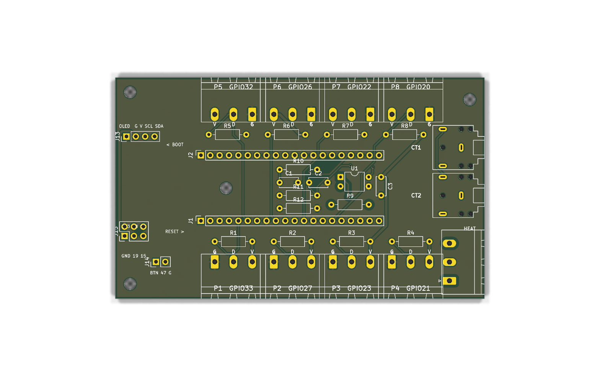
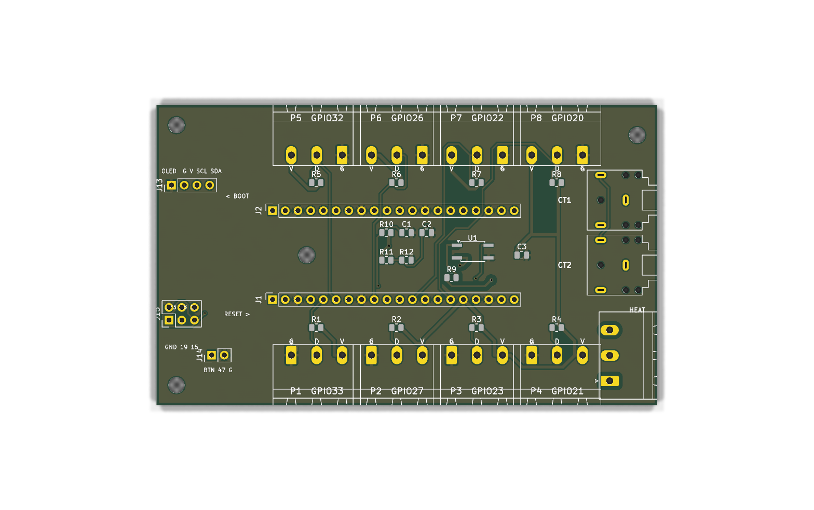

# Carrier board for the boiler probes

A 100 × 60 mm two-layer PCB that the Waveshare ESP32-P4-ETH (with its PoE module) plugs into. It gives the board
eight probe ports and the boiler module's other inputs, and fits the enclosure in `../enclosure/`.

| THT (hand-soldered) | SMD (factory-assembled resistors and capacitors) |
| --- | --- |
|  |  |

## What's on it

| Part | Where | Connects to |
| --- | --- | --- |
| 2 × 1×20 female headers (J1, J2) | middle | The ESP32-P4-ETH's header pins; its RJ45 end overhangs the board's left edge by 1.9 mm so the jack ends flush with the enclosure |
| 8 probe ports P1–P8 (J3–J10) | P1–P4 along the front (RESET side), P5–P8 along the back | One 1-Wire bus per port: P1 GPIO33, P2 GPIO27, P3 GPIO23, P4 GPIO21, P5 GPIO32, P6 GPIO26, P7 GPIO22, P8 GPIO20, each with its own 4.7 kΩ pull-up. Pins G (GND), D (data), V (3.3 V) |
| HEAT (J11) | right edge, front | The thermostat's 24 VAC call for heat on the outer two pins (middle empty), isolated by a PC814 / EL814 AC-input optocoupler through 10 kΩ. GPIO46 reads low while the call is on (10 kΩ pull-up, 1 µF to smooth the 120 Hz ripple) |
| CT1, CT2 (J12, J16) | right edge, back and middle | Two 3.5 mm stereo jacks (CUI SJ1-3523N) for SCT-013 1 V current clamps, plugged straight in. The SCT-013's plug uses tip and sleeve only: sleeve to GPIO16 (CT1) or GPIO17 (CT2), tip to BIAS (half of 3.3 V from 2 × 10 kΩ and 10 µF), ring not connected (OpenEnergyMonitor's wiring) |
| OLED (J13) | back left | GND, VCC (3.3 V), SCL (GPIO8), SDA (GPIO7): the pin order of the common 0.96" SSD1306 modules. The ESP board already has I²C pull-ups |
| BTN (J14) | front left | GPIO47 and GND, for a push button on the lid (use the internal pull-up) |
| SPARE (J15) | front left | 3V3, GND, GPIO48, GPIO19, GPIO18, GPIO15 |
| 4 × M3 holes | corners | The enclosure's standoffs |

RESET and BOOT on the ESP board stay reachable through the enclosure's side holes: nothing tall sits in line with
them (x = 16.1 mm).

The probe ports and the HEAT input use 3-pin 5.08 mm **pluggable** terminal blocks (right-angle header on the
board, screw plug on the cable), such as uxcell's "3-Pin 5.08mm Pitch Right Angle PCB Screw Terminal Block" sets:
nine of a pack of ten cover them. The footprint is KiCad's Phoenix MSTBA (same pin layout); check that the headers' pins
fit its 1.4 mm holes before ordering.

## Through-hole parts (THT version)

| Ref | Qty | Part | Notes |
| --- | --- | --- | --- |
| J1, J2 | 2 | 1×20 female pin header, 2.54 mm, 8.5 mm tall | Sockets for the ESP32-P4-ETH |
| J3–J11 | 9 | 3-pin 5.08 mm pluggable terminal block (right-angle header + screw plug) | 8 probe ports, HEAT |
| J12, J16 | 2 | 3.5 mm stereo jack, CUI SJ1-3523N (through-hole, right-angle) | Pump clamps CT1, CT2 (both board versions: soldered by hand) |
| R1–R8 | 8 | 4.7 kΩ, ¼ W, axial (6.3 mm body) | Probe pull-ups; holes 10.16 mm (0.4") apart |
| R9–R12 | 4 | 10 kΩ, ¼ W, axial | Heat-call input, heat-call pull-up, clamp bias (×2) |
| U1 | 1 | PC814 optocoupler, DIP-4 (AC input) | EL814 works too; a DIP-4 socket is optional |
| C1 | 1 | 1 µF ceramic, 5 mm lead spacing, ≥ 16 V | Heat-call smoothing |
| C2 | 1 | 10 µF ceramic, 5 mm lead spacing, ≥ 10 V | Clamp bias. A radial MLCC fits the holes; a small electrolytic needs its legs bent to 5 mm, + toward BIAS |
| C3 | 1 | 100 nF ceramic, 5 mm lead spacing | 3.3 V decoupling |
| J13 | 1 | 1×4 male pin header, 2.54 mm | OLED lead |
| J14 | 1 | 1×2 male pin header, 2.54 mm | Lid button |
| J15 | 1 | 2×3 male pin header, 2.54 mm | Spare GPIOs (optional) |

If the ESP32-P4-ETH came without headers: 2 × 1×20 male headers, soldered with the pins pointing down into the
sockets.

## Files

| File | What |
| --- | --- |
| `build_board.py` | Builds the board in KiCad 9's Python: parts, placement, nets, labels; then imports the routes and adds the ground pours |
| `build.sh` | The whole build in Docker: place, route with [Freerouting](https://github.com/freerouting/freerouting) 2.1.0, ground pours, DRC, Gerbers, drill files, renders, and for SMD the JLCPCB files |
| `jlc_files.py` | JLCPCB's BOM and placement (CPL) files for the SMD version |
| `fab/<tht or smd>/carrier-*.kicad_pcb` | The routed board, to open in KiCad |
| `fab/<tht or smd>/carrier-*-gerbers.zip` | **Upload this to the PCB maker**: Gerbers and drill files |
| `fab/smd/carrier-smd-jlc-bom.csv`, `-cpl.csv` | For JLCPCB's assembly service (top side) |
| `fab/<tht or smd>/drc.rpt` | KiCad's design rule check |

## Status

- **Both boards route completely** (0 unconnected pads; `build.sh` re-routes until KiCad agrees). The DRC's remaining items are silkscreen ones (outlines
  running past the board edge where the pluggable headers overhang it on purpose, labels touching outlines) and, on
  the SMD board, a ground pad joined to the pour by one thermal spoke instead of two. None affect the board.
- **Not built or tested yet.** Check before ordering:
  - the pluggable headers' pin size against the 1.4 mm holes;
  - JLCPCB's placement preview, especially U1's pin 1 (the KiCad coordinates have Y negative; JLCPCB reads KiCad
    files that way);
  - LCSC parts: C17673 (4.7 kΩ), C17414 (10 kΩ) and C49678 (100 nF) are JLCPCB basic parts; C15850 (10 µF),
    C28323 (1 µF) and C500388 (EL814S1(A)(TU)-V, SOP-4) were not confirmed as basic and may add an extended-part fee.
- **The ESPHome configuration** (`../boiler-probes.yaml`) uses this pinout: a bus per port, the heat call on
  GPIO46, the clamps on GPIO16/17, the OLED and the button.

## Building

On a machine with Docker, put `freerouting.jar` (v2.1.0 from the Freerouting releases page) in this folder and run
`./build.sh` (or `./build.sh tht` / `./build.sh smd`). Freerouting's routes differ a little from run to run.
