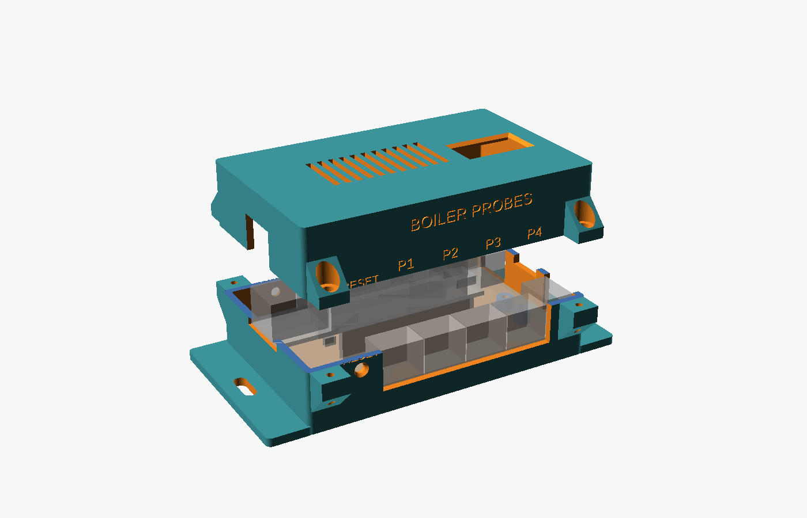
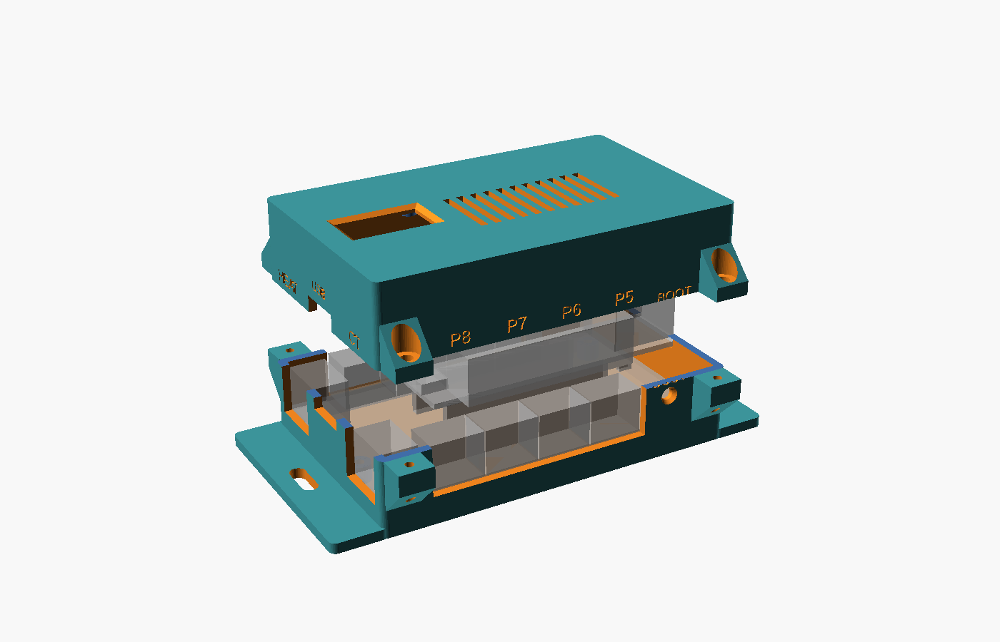
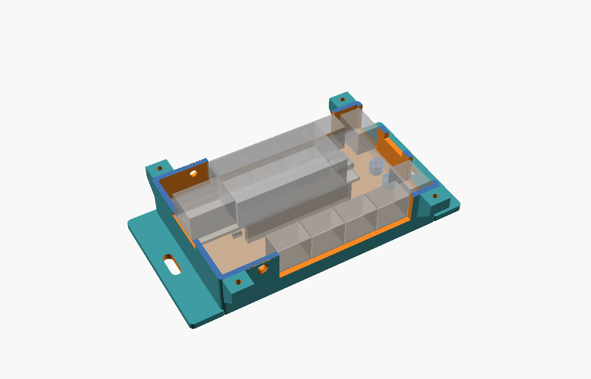
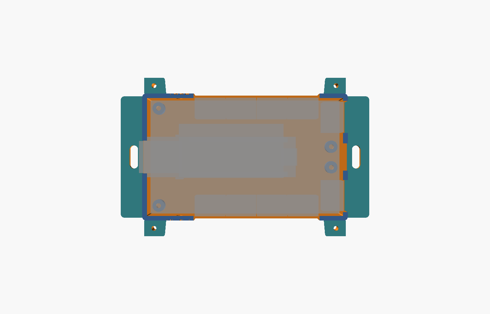
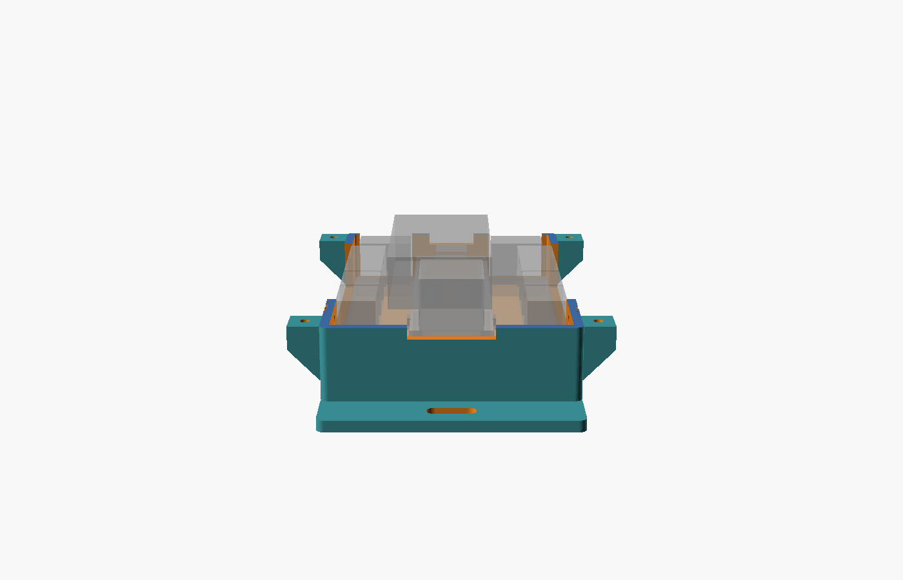
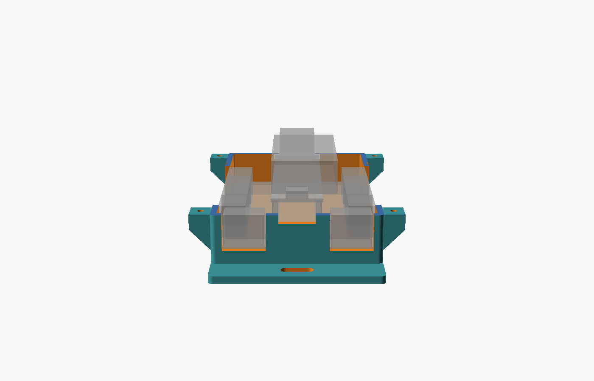
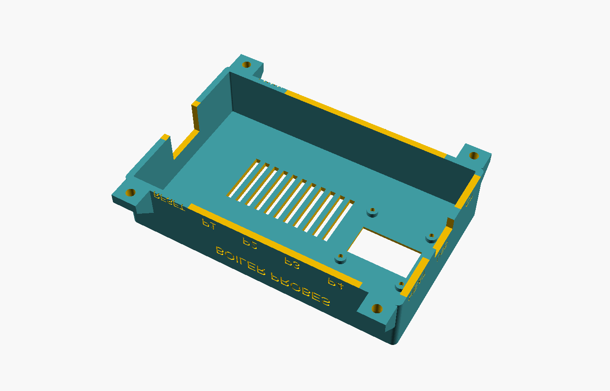
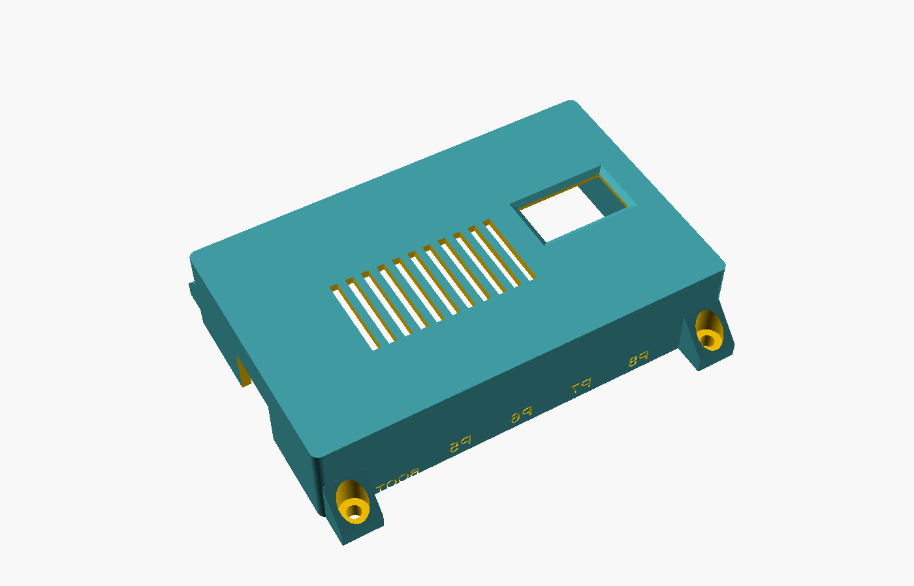

# Enclosure for the boiler probe board

A 3D-printed box for the **carrier board** (`../carrier/`) with the **Waveshare ESP32-P4-ETH and its PoE module**
plugged into it (`../boiler-probes.yaml`). Outside: 105.4 × 65.4 × 45.2 mm, plus a 14 mm screw tab on each end and
8 mm ears on the front and back.

It's in **two parts, split at the top of the port windows**, so the carrier drops into the base with its plugs:

- **`base.stl`:** floor, standoffs and the lower walls. The port windows, the RJ45 slot, the CT and HEAT windows and
  the lower half of the USB tunnel are slots open at the top.
- **`cover.stl`:** the upper walls and the top in one piece, with the OLED window, vents and labels. Its lower edge
  closes the slots; the RJ45 passes through a U open at its bottom edge.
- Four **ears** outside the front and back walls, at the split, hold them together with M3 screws from the top.



| Back: P5–P8, BOOT | Base, front | Base from above | Base, RJ45 end | Base, USB-C end | Cover: inside | Cover: outside |
| --- | --- | --- | --- | --- | --- | --- |
|  |  |  |  |  |  |  |

In the box images the boards show see-through: the carrier, its port blocks, the sockets, the ESP board, its jacks,
buttons and the PoE module. They're in OpenSCAD's preview only, never in the STL, to check that nothing is in the way.

## How it fits together

- **Carrier board:** sits on four M3 standoffs (5 mm, for the through-hole pins underneath).
- **ESP32 board:** plugs into the carrier's sockets 11 mm above it. Its **RJ45 jack's front is flush with the
  outside** of the end wall, so the latch can be pressed to unplug it: the board's end sits in the base's slot, and
  the cover's end wall fits around the jack.
- **Probe ports:** the pluggable blocks' faces are at the carrier's edges, in long windows in the front (P1–P4) and
  back (P5–P8) walls, so probes plug and unplug from outside. The windows are open-topped slots in the base, closed
  by the cover. The **CT** and **HEAT** blocks are behind windows in the
  USB-C end wall. Each port's name is engraved above it.
- **USB-C:** a 14 × 8 mm tunnel in the end wall, for flashing. The jack is 26 mm in, so it takes a plug with a slim,
  long body; day to day the board updates over the network.
- **RESET and BOOT:** countersunk holes in the front and back walls in line with the buttons, for a paperclip
  (labelled). BOOT is held while pressing RESET to flash over USB.
- **Joining the halves:** four ears at the split, outside the front and back walls, each with a 45° gusset so no
  supports are needed. An M3 × 12 self-tapping screw goes down through each cover ear (its gusset has a bore for the
  head and driver) into the base ear. The top has vents over the PoE module.
- **OLED:** a 0.96" SSD1306 module screws to four posts under the top, its glass behind a chamfered window, toward the
  USB-C end. A short 4-wire lead goes to the carrier's OLED header (GND, VCC, SCL, SDA). Set `oled = false` to leave it
  out (the box is then 6 mm lower).

The ESP board's sizes come from Waveshare's outline drawing (`ESP32-P4-ETH.zip` on their wiki): 78 × 21 mm, RJ45
16 × 13.3 mm and 0.8 mm past the edge, USB-C 9 × 3.2 mm, BOOT and RESET 18 mm from the RJ45 end. The photo
`images/poe_board.png` shows the PoE module (B) stacked on top, components down, overhanging the back edge.


## Still to measure

> **Not ready to print yet.** These are placeholders in `boiler-probes-box.scad`:

| Parameter | Now | What to measure |
| --- | --- | --- |
| `term_h` | 13 mm | Height of a pluggable block with its plug in, above the carrier (sets the port windows) |
| `poe_x`, `poe_l`, `poe_w`, `poe_y` | 19, 52, 27, 0 mm | The PoE module's footprint on the ESP board |
| `poe_top` | 14 mm | ESP board top to the PoE module's top |
| `btn_z` | −1.5 mm | RESET and BOOT's centre height from the ESP board's bottom |
| `sock_h` | 11 mm | ESP board bottom above the carrier: the female headers' height plus the male headers' spacer |
| `oled_pcb`, `oled_holes` | 27.3 × 27.8, 23.3 × 23.8 mm | The OLED module's board and M2 hole spacing (these modules vary) |
| `oled_view_dy`, `oled_glass_h`, `oled_depth` | −1.5, 1.8, 6 mm | The display's offset from the module's centre, its glass height, and the module's depth with its wires |

## Printing

- **PETG** (it sits in a warm boiler room; PLA softens at about 55 °C). For PLA, set `fit = 0.15`.
- 0.2 mm layers, 3 perimeters, 20% infill, no supports.
- Base: open side up. Cover: top face down (`cover.stl` is already turned over).
- Hardware: 4 × M3 × 6 self-tapping screws for the carrier, 4 × M3 × 12 self-tapping screws to join base and cover,
  4 × M2 × 4 self-tapping screws for the OLED, and 2 × 4 mm screws through the tabs.
- A cheap fit check first: print only the RJ45 end of the base (cut the STL in the slicer about 25 mm from that end).

## Rendering

In OpenSCAD: open the `.scad`, set `PART` to `"base"` or `"cover"` at the top, render (F6) and export STL. Without
OpenSCAD installed, the official image works:

```
docker run --rm -v "$PWD":/w -w /w openscad/openscad:dev \
  openscad -D 'PART="base"' --backend=manifold -o base.stl boiler-probes-box.scad
```

Add `--imgsize=1400,900 --viewall --autocenter --camera=0,0,0,35,0,210,0 -o box.png` for a preview image (with
`--render` it leaves out the see-through boards).
