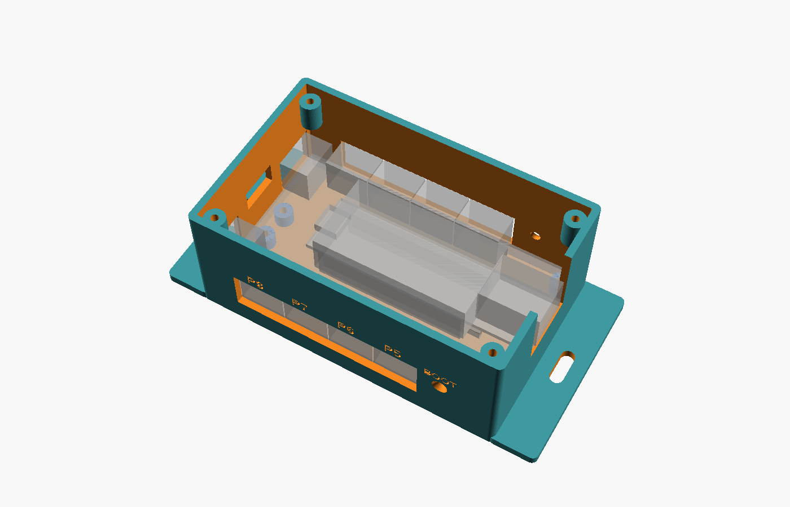
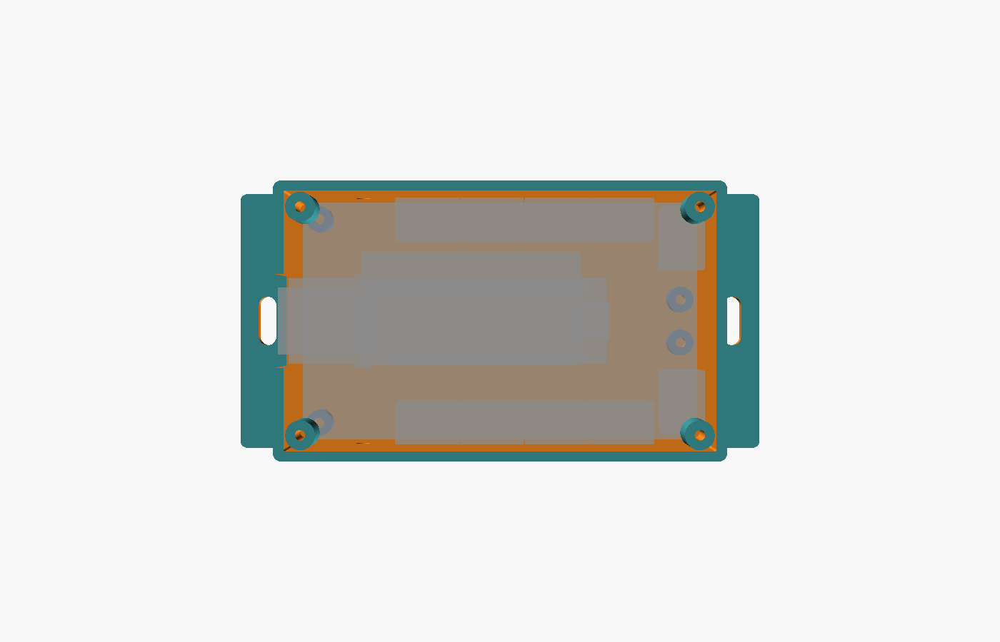
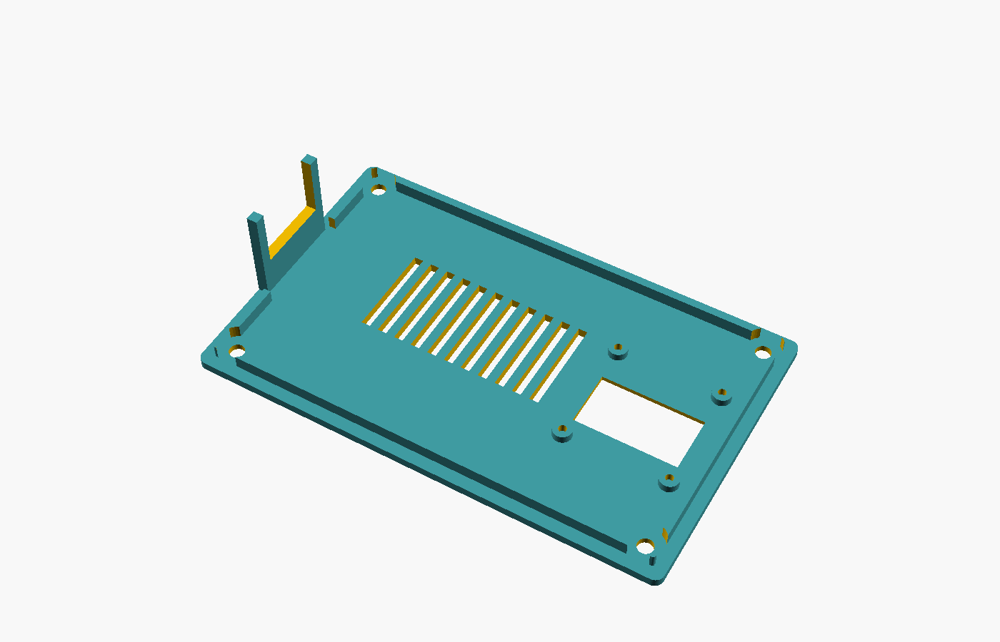
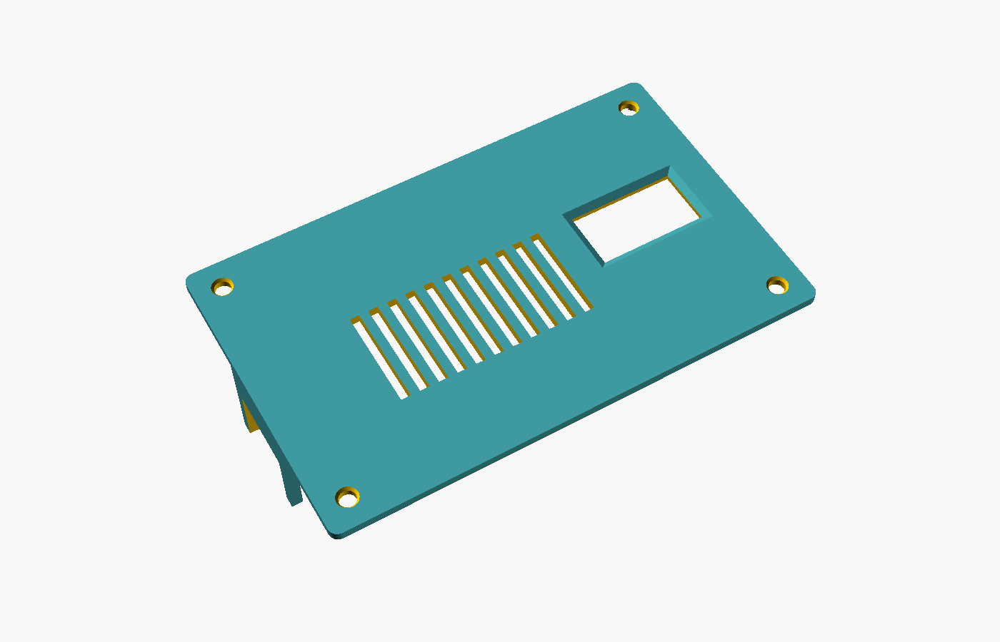

# Enclosure for the boiler probe board

A 3D-printed box for the **carrier board** (`../carrier/`) with the **Waveshare ESP32-P4-ETH and its PoE module**
plugged into it (`../boiler-probes.yaml`). Outside: 105.4 × 65.4 × 43.2 mm, plus a 14 mm screw tab on each end.


| Front: P1–P4, RESET | Back: P5–P8, BOOT | USB-C end: HEAT, USB, CT | RJ45 end, flush | Inside, from above | Lid: inside | Lid: outside |
| --- | --- | --- | --- | --- | --- | --- |
|  |  |  |  |  |  |  |

In the box images the boards show see-through: the carrier, its port blocks, the sockets, the ESP board, its jacks,
buttons and the PoE module. They're in OpenSCAD's preview only, never in the STL, to check that nothing is in the way.

## How it fits together

- **Carrier board:** sits on four M3 standoffs (5 mm, for the through-hole pins underneath).
- **ESP32 board:** plugs into the carrier's sockets 11 mm above it. Its **RJ45 jack's front is flush with the
  outside** of the end wall, so the latch can be pressed to unplug it. The board's end drops into a notch in that wall,
  open to the top, and a tongue on the lid closes the notch above the board, around the jack.
- **Probe ports:** the pluggable blocks' faces are at the carrier's edges, behind long windows in the front (P1–P4) and
  back (P5–P8) walls, so probes plug and unplug from outside. The **CT** and **HEAT** blocks are behind windows in the
  USB-C end wall. Each port's name is engraved above it.
- **USB-C:** a 14 × 8 mm tunnel in the end wall, for flashing. The jack is 26 mm in, so it takes a plug with a slim,
  long body; day to day the board updates over the network.
- **RESET and BOOT:** countersunk holes in the front and back walls in line with the buttons, for a paperclip
  (labelled). BOOT is held while pressing RESET to flash over USB.
- **Lid:** screwed down with four M3 screws into bosses that hang from the wall tops at the corners on 45° gussets
  (no supports needed), clear of everything on the carrier. It has a lip inside the walls and vents over the PoE
  module.
- **OLED:** a 0.96" SSD1306 module screws to four posts under the lid, its glass behind a chamfered window, toward the
  USB-C end. A short 4-wire lead goes to the carrier's OLED header (GND, VCC, SCL, SDA). Set `oled = false` to leave it
  out (the box is then 6 mm lower).

The ESP board's sizes come from Waveshare's outline drawing (`ESP32-P4-ETH.zip` on their wiki): 78 × 21 mm, RJ45
16 × 13.3 mm and 0.8 mm past the edge, USB-C 9 × 3.2 mm, BOOT and RESET 18 mm from the RJ45 end. The photo
`images/poe_board.png` shows the PoE module (B) stacked on top, components down, overhanging the back edge.


## Still to measure

> **Not ready to print yet.** These are placeholders in `boiler-probes-box.scad`:

| Parameter | Now | What to measure |
| --- | --- | --- |
| `term_h` | 13 mm | Height of a pluggable block with its plug in, above the carrier (sets the port windows) |
| `poe_x`, `poe_l`, `poe_w`, `poe_y` | 19, 52, 27, 0 mm | The PoE module's footprint on the ESP board |
| `poe_top` | 14 mm | ESP board top to the PoE module's top |
| `btn_z` | −1.5 mm | RESET and BOOT's centre height from the ESP board's bottom |
| `sock_h` | 11 mm | ESP board bottom above the carrier: the female headers' height plus the male headers' spacer |
| `oled_pcb`, `oled_holes` | 27.3 × 27.8, 23.3 × 23.8 mm | The OLED module's board and M2 hole spacing (these modules vary) |
| `oled_view_dy`, `oled_glass_h`, `oled_depth` | −1.5, 1.8, 6 mm | The display's offset from the module's centre, its glass height, and the module's depth with its wires |

## Printing

- **PETG** (it sits in a warm boiler room; PLA softens at about 55 °C). For PLA, set `fit = 0.15`.
- 0.2 mm layers, 3 perimeters, 20% infill, no supports.
- Box: open side up. Lid: outside face down (the lip up).
- Hardware: 4 × M3 × 6 self-tapping screws for the carrier, 4 × M3 × 10 countersunk self-tapping screws for the lid,
  4 × M2 × 4 self-tapping screws for the OLED, and 2 × 4 mm screws through the tabs.
- A cheap fit check first: print only the RJ45 end (cut the STL in the slicer about 25 mm from that end).

## Rendering

In OpenSCAD: open the `.scad`, set `PART` to `"box"` or `"lid"` at the top, render (F6) and export STL. Without
OpenSCAD installed, the official image works:

```
docker run --rm -v "$PWD":/w -w /w openscad/openscad:dev \
  openscad -D 'PART="box"' --backend=manifold -o box.stl boiler-probes-box.scad
```

Add `--imgsize=1400,900 --viewall --autocenter --camera=0,0,0,35,0,210,0 -o box.png` for a preview image (with
`--render` it leaves out the see-through boards).
