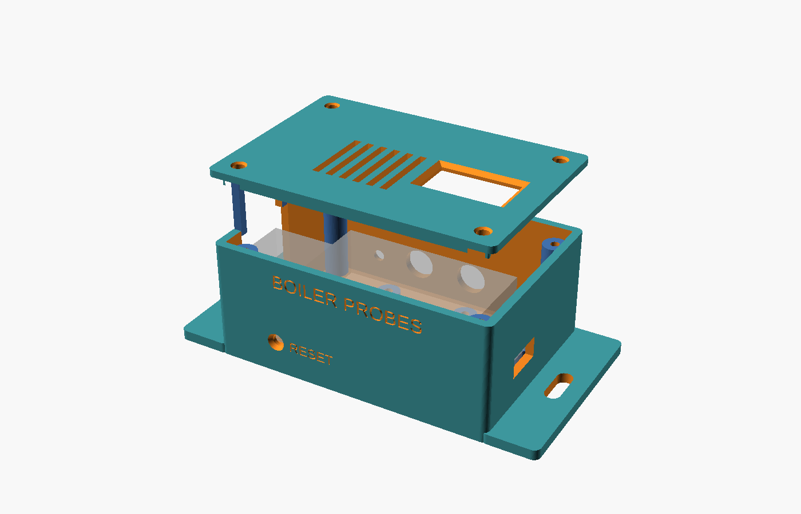
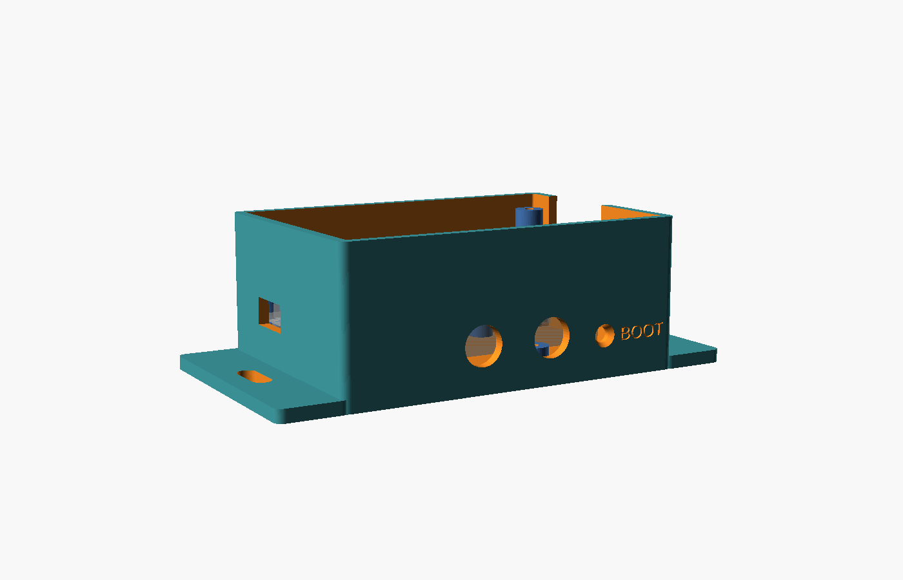

# Enclosure for the boiler probe board

A 3D-printed box for the **Waveshare ESP32-P4-ETH with its PoE module** (the board in `../boiler-probes.yaml`):
the board on four standoffs with the RJ45 jack's front flush with the outside of its end wall (so the latch can be
pressed to unplug it), USB-C (for flashing) through the other end wall, a bay beside the board
for the probe buses' screw terminal block and the 4.7 kΩ pull-ups, two grommet holes for the probe cables, a
labelled holes for pressing RESET (front wall) and BOOT (back wall) with a paperclip, screw tabs for the wall, and a screwed lid with
vents over the PoE module and a window for a 0.96" SSD1306 OLED that shows the readings.

The layout follows the photo of the board, `images/poe_board.png`. The PoE module (B) stacks **on top**,
components down, plugged into the 6-pin header just behind the RJ45, and overhangs the board's back edge. The header
pins point down. RESET is a side-press button under the board's front long edge just behind the RJ45, and BOOT is
on the other edge.


> **Not ready to print yet.** The board's sizes come from Waveshare's outline drawing (`ESP32-P4-ETH.zip` on their
> wiki): 78 × 21 mm, RJ45 16 × 13.3 mm and 0.8 mm past the edge, USB-C 9 × 3.2 mm, header pins 8.3 mm below,
> mounting holes at 22.3 and 76.5 mm from the RJ45 end and 18.2 mm apart, BOOT and RESET 18 mm from the RJ45 end.
> The PoE module's size isn't published. The sizes marked
> `MEASURE` in `boiler-probes-box.scad` are placeholders until the real board is measured. The STLs here are
> rendered from those placeholders.

| File | What |
| --- | --- |
| `boiler-probes-box.scad` | The model (OpenSCAD). Every size is a parameter at the top. |
| `box.stl`, `lid.stl` | The two parts, rendered from the `.scad` with the current parameters |
| `images/` | Previews of the same render |

Outside: 82.2 × 56.3 × 34.6 mm, plus a 14 mm screw tab on each end. In the box previews the board, its jacks and the
space under it show see-through (OpenSCAD's preview only; they're never in the STL), to check that nothing is in the way.



| Box: RJ45 end, flush | Box: front, RESET | Box: back, BOOT and grommets | Box: inside | Box: USB-C end | Lid: lip side and tongue | Lid: outside |
| --- | --- | --- | --- | --- | --- | --- |
|  |  |  |  |  |  |  |

**RJ45 end.** The board's end sits in a notch in the end wall, open to the top and as wide as the board, from just
below the PCB: the board drops in from above and the jack's front ends flush with the outside. The lid has a tongue
that closes the notch above the PCB around the jack (two fingers beside it and a bar over it), and its lip is cut
away over the jack. The lid-screw posts fill the inside corners and the board runs beside the two front ones.

## Still to measure

| Parameter | Now | What to measure |
| --- | --- | --- |
| `poe_x`, `poe_l`, `poe_w`, `poe_y` | 19, 52, 27, 0 mm | The PoE module's footprint: where it starts from the RJ45 end, its length, its width, and its front edge from the board's front edge |
| `poe_top` | 14 mm | Main PCB top to the PoE module's top |
| `reset_z` | −1.5 mm | The RESET and BOOT buttons' centre height from the PCB bottom (negative is below) |
| `hole_d` | 2.6 mm | Mounting hole diameter |
| `oled_pcb`, `oled_holes` | 27.3 × 27.8, 23.3 × 23.8 mm | The OLED module's board and its M2 hole spacing (these modules vary) |
| `oled_view_dy`, `oled_glass_h` | −1.5, 1.8 mm | The display's offset from the module's centre (away from the pins), and its glass height above the module board |
| `oled_depth` | 6 mm | From the glass front to the back of the module and its wires; the box is this much taller for it |

**OLED.** The lid has a window, chamfered on the outside, and four posts underneath that the module screws to
with M2 self-tapping screws, its glass just behind the window and its pins toward the back. It sits toward the
USB-C end, and the vents stop short of it. It's wired to the carrier board's OLED header (`../carrier/`); with
the board alone, use the header pins 3V3, GND, GPIO7 (SDA) and GPIO8 (SCL). Set `oled = false` to leave it out
(the box is then 6 mm lower).

## Printing

- **PETG** (it sits in a warm boiler room; PLA softens at about 55 °C). For PLA, set `fit = 0.15`.
- 0.2 mm layers, 3 perimeters, 20% infill, no supports.
- Box: open side up. Lid: outside face down (the lip up).
- Hardware: 4 × M2 × 4 self-tapping screws for the OLED, 4 × M2.5 self-tapping screws for the board, 4 × M3 × 8 countersunk self-tapping screws for the lid,
  2 × M3 for the terminal block (or glue it and set `tb_screws = false`), 2 × 9 mm grommets (or PG7 cable glands
  with `grommet_d = 12.5`), and 2 × 4 mm screws through the tabs.
- A cheap fit check first: print only the RJ45 end (cut the STL in the slicer about 10 mm from that end).

## Rendering

In OpenSCAD: open the `.scad`, set `PART` to `"box"` or `"lid"` at the top, render (F6) and export STL. Without
OpenSCAD installed, the official image works:

```
docker run --rm -v "$PWD":/w -w /w openscad/openscad:dev \
  openscad -D 'PART="box"' --backend=manifold -o box.stl boiler-probes-box.scad
```

Add `--render --imgsize=1400,900 --viewall --autocenter --camera=0,0,0,35,0,210,0 -o box.png` for a preview image.
